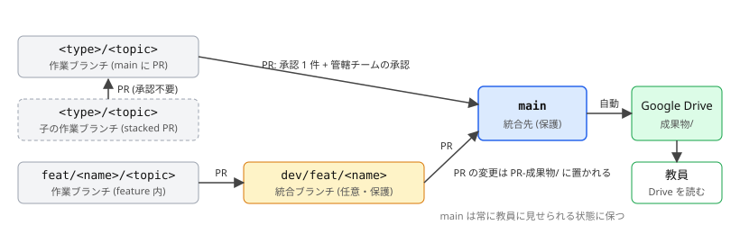

# CONTRIBUTING

Kinchan リポジトリでの作業の決まり。設計の経緯は [ADR-0004](docs/ADR/0004-branch-strategy.md) を参照。

## ブランチ



| ブランチ | 役割 | 決まり |
|---|---|---|
| `main` | チームの統合先。常に教員に見せられる状態に保つ | 直接 push 不可。PR 必須。削除・force push 不可 |
| `<type>/<topic>` | 作業ブランチ。`docs/` `feat/` `fix/` `ci/` など | `main` から切り、`main` に PR を出す (stacked PR の子は親の作業ブランチに出す)。マージすると自動で削除される |
| `dev/feat/<name>` | 子の PR ごとに承認を必須にして統合を続ける feature の統合ブランチ (任意) | `main` から切る。直接 push 不可。PR 必須。`main` に PR を出し、マージ後に削除 |
| `feat/<name>/<topic>` | `dev/feat/<name>` に対する作業ブランチ | `dev/feat/<name>` に PR を出す |

- 1 PR で終わる変更は `dev/` を経由せず `main` に直接 PR を出す。
- `main` への PR の head ブランチ (親) に、別の作業ブランチ (子) から PR を出してよい (stacked PR)。親の作者は自分でも他のメンバーでもよい。例: #129 #131 → `docs/add-sequence-diagrams` (#125 の head)、#116 → `Screen-transition-diagram` (#107 の head)。
  - 親は保護されていないため、子の PR は承認なしでマージできる。レビューは親から `main` への PR で、子の変更を含めて受ける。
  - 他のメンバーの親に出した子の PR は、親の作者がマージする。
- 未完成の変更を `main` に入れない。途中の状態を共有したいときは、stacked PR の親ブランチか `dev/feat/<name>` を使う。
- `dev/feat/<name>` が長く残ると `main` から離れる。`main` の取り込みも PR で行うため、feature は小さく区切って早く `main` に入れる。
- Claude が作るブランチ (`@claude` の `claude/issue-<番号>-...`、Claude Code のセッションの `claude/<名前>`) は命名規則の対象外。base の選び方は他の作業ブランチと同じ。

## PR とレビュー

- PR 本文はテンプレートに従う。他チームの管轄に触れた場合はその旨を書く。
- `main` と `dev/**` への PR は、作者以外の承認が 1 件以上必要。
- 変更したパスに応じて、次のチームの承認が必須になる。複数に該当すれば全チームの承認が必要。

| パス | 必須レビュアー (org Team) |
|---|---|
| `frontend/**` | frontend |
| `backend/**` | backend |
| `.github/**` `database/**` `deploy/**` `compose*.yaml`、および任意の階層の `Dockerfile*` `.dockerignore` | platform (Infra / CI / Database) |
| `tools/drive-delivery/**` (manifest.json を除く) | pm-qa (PM)。納品スクリプトは PM の Google アカウントで動くため |
| `tools/drive-delivery/manifest.json` | platform (納品対象の変更) |
| 上記以外 (`docs/` など) | 指定なし。作者以外の承認 1 件で通る |

- 例: `backend/Dockerfile` を変更する PR は backend と platform の両方の承認が必要。
- 承認後に push すると承認は無効になる。再度レビューを依頼する。
- 自分の PR は自分で承認できない。必須チームのメンバーが自分だけの場合は、同じチームの他のメンバーに依頼する。
- マージ方法は merge / squash / rebase のいずれも可。これまでの PR は merge commit で揃えている。
- Repository admin (PM) は緊急時に限り、PR のマージ時にルールを bypass できる。直接 push はできない。

### ADR の番号

設計の経緯は [ADR-0045](docs/ADR/0045-detect-adr-number-collisions.md) を参照。

- 新しい ADR は、`main` と open な PR (draft を含む) で使われている最大の番号 + 1 を使う。次の番号は次のコマンドで表示できる (`gh` のログインが必要)。

  ```sh
  python3 .github/scripts/adr_numbers.py            # main の番号、open な PR の ADR、重複、次の番号
  python3 .github/scripts/adr_numbers.py --pr 120   # 1 つの PR だけ判定する
  ```

- 番号は PR を開いた時点で他のメンバーから見える。ADR を書き始めたら、draft でも早めに PR を開く。
- PR には status `adr-number` が付き、failure の PR は `main` にマージできない。
  - failure: ファイル名が `NNNN-<slug>.md` でない、番号が `main` の別のファイルと重複している、PR の中で番号が重複している。
  - success で注記あり: 番号が他の open な PR と重複している。先にマージされた方が番号を使い、`main` が進むと他方は failure になる。
- 重複したら、後からマージする側が番号を変える。ファイル名を status の説明に表示された次の番号に変え、その ADR を指す参照 (`ADR-NNNN` の表記と `docs/ADR/NNNN-slug.md` などのリンク) を書き換える。
- open な PR が使っている番号は `main` で欠番に見えてもよい。close された PR の番号による欠番は埋めない。

## 教員レビュー

教員は Google Drive の成果物フォルダ (後述) を読む。Markdown は Google Docs に変換して置かれる。教員は GitHub の PR やタグを操作しない。

- `成果物/` は `main` の最新に追従する。未完成の変更を `main` に入れない。
- `main` を base とする PR (draft を除く) の変更は、PR ごとに `PR-成果物/` に置かれる。stacked PR の子の変更は、親にマージされると親の `PR-成果物/` に置かれる。
- 指摘を受けたら、通常の PR で修正する。
- 教員レビューのためのタグと GitHub Release は作らない ([ADR-0043](docs/ADR/0043-review-on-drive-without-tags.md))。既存の `review/*` `approved/*` タグと Release は過去の記録として残す。これらのタグの作成・変更・削除は pm-qa チームのみ。

### Google Drive への納品

Apps Script が 10 分ごとに GitHub を読み、Shared Drive の指定フォルダに成果物を置く (Markdown は Google Docs に変換)。

- `成果物/`: `main` の最新に追従する。
- `PR-成果物/#<番号> <タイトル>-成果物/`: `main` を base とする PR (draft を除く) の差分に含まれる成果物。PR が close (merge を含む) されるか draft に戻されると、フォルダはゴミ箱に移る。

置くファイルと置き場所は `tools/drive-delivery/manifest.json` に書いたものだけで、変更は PR で行う。仕組みと設定は [tools/drive-delivery/README.md](tools/drive-delivery/README.md) と [ADR-0042](docs/ADR/0042-deliver-main-and-pr-to-drive.md) を参照。

## 困ったとき

| 表示 | 意味 | 対処 |
|---|---|---|
| `Changes must be made through a pull request` | 保護されたブランチへ直接 push した | 作業ブランチを切って PR を出す |
| `Review required` / `Waiting on required reviewers` | 必須レビュアーの承認が足りない | 表示されたチームのメンバーに依頼する |
| `GH013: Repository rule violations found` | Rulesets に違反した。続く行に理由がある | 理由に従う |
| 承認が消えた | 承認後に push した | 再度レビューを依頼する |
| `adr-number` が failure | ADR のファイル名が形式に合わない、または番号が `main` か PR 内で重複している | status の説明に表示された次の番号にファイル名を変え、参照を書き換える ([ADR の番号](#adr-の番号)) |

## 自動化

| 名前 | 起動 | 動作 |
|---|---|---|
| Claude Code Review | PR を開く、draft を解除する、再オープンする、`claude-review` ラベルを付ける (ラベルは draft の PR でも動く) | 差分をレビューし、inline comment と総評を書く。push では動かない。ラベルは実行後に自動で外れるので、再レビューはラベルを付け直す |
| Claude Code | Issue / PR のコメント、PR のレビュー、Issue の本文かタイトル (作成時・assign 時) に `@claude` と書く | 質問に答える、調査する。承認・編集・close はしない。write 権限のあるメンバーのみ起動できる |
| Issue duplicate check | Issue を開く | 既存 Issue との重複を判定し、重複があればコメントする |
| ADR number check | PR を開く、PR に push する、再オープンする。`docs/ADR/**` を変える `main` への push と手動の実行では open な PR をすべて判定し直す | ADR の番号を判定し、PR の head に status `adr-number` を設定する。コメントはしない。詳細は status のリンク先の job summary にある |

## 設定の変更

ブランチ保護は GitHub の Rulesets で設定している。内容は `.github/rulesets/*.json` と一致させる。

1. JSON を変更する PR を出す (platform の承認が必須)。
2. マージ後、PM が適用する。

   ```sh
   gh api -X PUT repos/KIS18-GDS-Team7/Kinchan/rulesets/<id> --input .github/rulesets/<name>.json
   ```

   ID の対応は [.github/rulesets/README.md](.github/rulesets/README.md) にある。

CODEOWNERS (`.github/CODEOWNERS`) は所有の宣言と review request の自動化に使う。承認の強制は Rulesets 側で行う。

## 関連文書

- [ADR-0001 ADRを書く](docs/ADR/0001-record-ADR.md)
- [ADR-0002 ドキュメントでは人間的な表現を使わない](docs/ADR/0002-avoid-human-centric-expressions.md)
- [ADR-0003 曖昧な語を使わない](docs/ADR/0003-avoid-ambiguous-terms.md)
- [ADR-0004 ブランチの運用と必須レビューを定める](docs/ADR/0004-branch-strategy.md)
- [ADR-0042 Google Drive の成果物フォルダを main と PR ごとに分けて置く](docs/ADR/0042-deliver-main-and-pr-to-drive.md)
- [ADR-0043 教員レビューを Google Drive の成果物フォルダで受け、タグと Release の記録をやめる](docs/ADR/0043-review-on-drive-without-tags.md)
- [ADR-0044 main への PR の head に stacked PR を出してよい](docs/ADR/0044-allow-stacked-prs.md)
- [ADR-0045 ADR の番号の重複を status check で検知する](docs/ADR/0045-detect-adr-number-collisions.md)
- [AGENTS.md](AGENTS.md): AI コーディングエージェント向けの決まり
