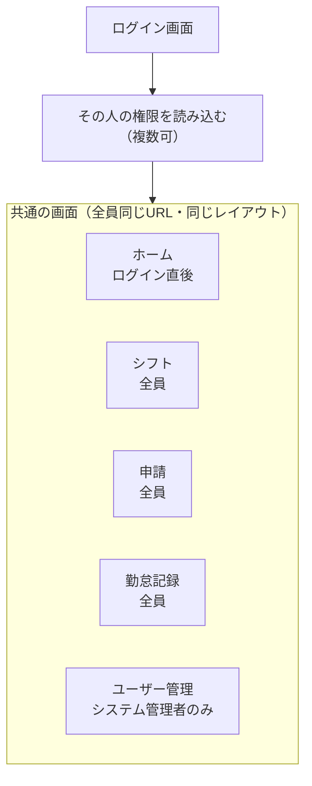

# Kinchan Webデザイン方針まとめ

2026-10-22 · がく

## 前提

Kinchan のリポジトリは、まだ要件定義書・ユースケース図・ADR だけの段階で、コードはありません。この文書は、その要件を前提に Web のデザイン方針をまとめたものです。

| アクター | 主な端末 | 主な用途 |
| --- | --- | --- |
| 従業員 | 個人のスマホ（iPhone / Android） | 打刻、シフト希望、各種申請 |
| 勤怠管理者 | PC（承認はスマホでも） | 申請の承認・却下、シフト作成、勤務実態の表示 |
| 管理者 | PC（Mac / Windows） | ユーザー・権限・所属店舗・勤務可能時間・休憩時間の設定 |

これまでの話し合いで決まったこと：

- 1人が複数のロールを持てる（例：勤怠管理者も自分で打刻する）
- 打刻は従業員個人のスマホで行う
- 今回は打刻の仕組みやデータに要素を足さず、Web のデザイン（画面の見せ方と操作）だけを扱う
- Flask で開発する（要件 9章）。PWA にするかは未決

ADR-0003 に従い、「マイページ」という語は使いません。この文書の画面名はすべて仮称で、用語集に定義してから確定します。

## 画面の流れ

画面とURLは全員共通で、画面の中に表示される要素（メニュー項目、タブ、ボタン、一覧の範囲）だけが権限で変わります。ロールごとに画面を分けないので、ロール切り替えも不要になります。

1. **ログイン**：全員が同じログイン画面を使う（UC-001）。
2. **権限の読み込み**：その人の権限（従業員・勤怠管理者・管理者の組み合わせ）を読み込む。
3. **ホーム**：ログイン後は全員がホームを開く。ホームに出るカードが権限で変わる。
4. **メニューと画面内の要素**：権限のない項目は表示しない。複数の権限を持つ人には、その合計をまとめて表示する。
5. **サーバー側のチェック**：表示を隠すだけでなく、権限のない操作は URL を直接開いてもサーバーで拒否する。勤怠管理者には担当店舗の従業員だけを表示する。
6. **ログアウト**：ヘッダーのメニューから行い、ログイン画面に戻る（UC-002）。

### 権限ごとに表示される要素

| 画面 | 要素 | 全員（従業員として） | 勤怠管理者 | システム管理者 | 関連UC |
| --- | --- | --- | --- | --- | --- |
| ホーム | 打刻カード（勤務ステータス、打刻ボタン、今日のシフト） | ○ | — | — | UC-304, UC-305 |
| ホーム | 本日の勤務状況、承認待ちの件数 | — | ○ | — | UC-213 |
| シフト | 自分の登録シフト、シフト希望の提出・一覧 | ○ | — | — | UC-307, UC-308, UC-311 |
| シフト | 「店舗のシフト表」タブ（登録・変更・削除）、「届いたシフト希望」タブ（一覧・承認・却下） | — | ○ | — | UC-203〜208 |
| 申請 | 自分の申請の送信・履歴 | ○ | — | — | UC-306, UC-309, UC-310 |
| 申請 | 「承認待ち」タブ（勤怠修正申請とシフト日時変更申請の承認・却下） | — | ○ | — | UC-209〜211, UC-214〜216 |
| 勤務実績 | 自分の予定と実績 | ○ | — | — | UC-303（#61） |
| 勤務実績 | 従業員の切り替え、勤怠の修正ボタン | — | ○ | — | UC-212, UC-213 |
| ユーザー管理 | 画面そのもの（メニュー項目ごと非表示） | — | — | ○ | UC-103〜116 |

例えば、従業員と勤怠管理者の両方を持つ店長は、ホームで打刻カードと承認待ちの件数を並べて見られます。システム管理者だけの人は、ホームに出すものがないと空になるため、ユーザー数などを出すかは未決です。

### システム管理者と勤怠管理者は別の権限

画面は共通でも、この2つは独立した権限として扱い、片方を持っていてももう片方の操作はできません。要件定義書の「管理者」は、勤怠管理者と区別するため、この文書では「システム管理者」と呼びます（用語集への登録が必要、ADR-0003）。

|  | システム管理者 | 勤怠管理者 |
| --- | --- | --- |
| 扱うもの | アカウントと設定（ユーザー、権限、所属店舗、勤務可能時間、休憩時間） | 勤怠の中身（シフト、申請の承認・却下、勤務実態と修正） |
| 範囲 | 会社全体 | 担当する店舗・事業部の従業員だけ |
| メニューに出るもの | ホーム、ユーザー管理 | ホーム、シフト、申請、勤務実績 |
| できないこと | シフトの作成、申請の承認、勤怠の修正 | ユーザーの登録・削除、権限の付与 |

両方の権限を同じ人に付与することはできます。その場合は、両方のメニューと要素をまとめて表示します。

### シフト画面のタブ

シフト画面は全員共通で、勤怠管理者にだけ後ろ2つのタブが表示されます。

| タブ | 表示される人 | 内容 | 関連UC |
| --- | --- | --- | --- |
| 登録シフト | 従業員 | 自分の確定シフト（リスト / カレンダー）。シフト日時変更の申請へ進むボタン | UC-308, UC-309 |
| シフト希望 | 従業員 | 自分の希望の提出と一覧 | UC-307, UC-311 |
| 店舗のシフト表 | 勤怠管理者のみ | 担当店舗の従業員×日付の表。シフトの登録・変更・削除 | UC-203〜205 |
| 届いたシフト希望 | 勤怠管理者のみ | 従業員から届いた希望の一覧。承認するとシフトとして登録、却下すると従業員に結果を通知 | UC-206〜208 |

シフト希望の承認は、シフト表を見ながら判断するものなので、申請画面ではなくシフト画面に置きます。従業員の権限を持たない勤怠管理者には、後ろ2つのタブだけが表示されます。

## 既存アプリ調査の要点

既存アプリの弱点は、打刻までの操作の多さ、申請メニューの階層の深さ、シフト希望を1日ずつ入力する手間、の3つに集中しています。公式ヘルプに書かれた画面構成と操作手順、ITreview・BOXIL のレビューをもとにしています（スクリーンショットの直接比較はしていません）。

| 画面 | 既存アプリの現状 | 利用者の不満 |
| --- | --- | --- |
| 打刻 | [ジョブカン](https://jobcan.zendesk.com/hc/ja/articles/201238535--%E3%83%A2%E3%83%90%E3%82%A4%E3%83%AB%E3%83%9E%E3%82%A4%E3%83%9A%E3%83%BC%E3%82%B8-%E6%89%93%E5%88%BB%E3%82%92%E3%81%99%E3%82%8B)は打刻タブ→モードと場所を選択→打刻→位置情報取得→「はい」。[KING OF TIME](https://support.ta.kingoftime.jp/hc/en-us/articles/22991010617881--Smartphone-app-employee-the-operation-method)は打刻の種類を選んでからボタン。[マネーフォワード](https://biz.moneyforward.com/support/attendance/news/new-feature/20221004.html)は2022年に、勤務状態に応じたボタンだけを青く表示する形に改修 | 二重打刻してしまう。二重打刻で出勤と退勤が逆に自動判定された。位置情報が取れない |
| 打刻の修正申請 | [マネーフォワード](https://biz.moneyforward.com/support/attendance/guide/timestamp/timestamp03.html)はメニュー→日次勤怠→日付→詳細→種類→入力→申請。[freee](https://support.freee.co.jp/hc/ja/articles/4411633194905--%E5%BE%93%E6%A5%AD%E5%93%A1%E7%94%BB%E9%9D%A2-%E6%93%8D%E4%BD%9C%E3%83%A1%E3%83%8B%E3%83%A5%E3%83%BC-%E4%B8%80%E8%A6%A7-%E3%83%A2%E3%83%90%E3%82%A4%E3%83%AB)は各種申請の下に最大8項目 | 打刻画面と別の場所で申請するので忘れる。申請がどこで止まっているか分からない |
| ナビゲーション | KING OF TIME は下のアイコン3つ。マネーフォワードは右上の「≡」メニュー | KING OF TIME は「メニューが3つで覚えやすい」と評価されている |
| シフト希望 | [Airシフト](https://airregi.jp/faq/shift/sft_manual.pdf)は希望が管理者側の下書きに自動で入る | ジョブカンは初期値が9〜18時固定でコピーできず、1日ずつ手入力 |
| 表示形式 | KING OF TIME はタイムカード風の縦リスト | カレンダー形式でも見たい |
| 承認 | マネーフォワードは4タブの一覧から1件ずつ詳細を開いて承認 | KING OF TIME では管理者がスマホから承認できず、外出中に処理できない |
| 初回利用 | — | 「ホーム画面に追加」のメッセージを閉じると戻せない。設定が細かすぎて運用までが大変（ジョブカン） |

## 今回のスコープ

機能とデータは要件定義書のとおりに固定し、画面の見せ方と操作のしやすさで既存アプリと差をつけます。

### デザインだけで実現する改善

| 対象 | 改善内容 | 関連UC |
| --- | --- | --- |
| 打刻 | 勤務状態に合ったボタンを1つだけ大きく表示。ラベルは「出勤する」「退勤する」。打刻後に記録した時刻を秒まで表示 | UC-304, UC-305 |
| ナビゲーション | 下のタブ最大5つ（ホーム・シフト・申請・勤務実績・ユーザー管理）、階層を深くしない。権限のない項目はメニューに出さない | — |
| 申請 | 履歴に「変更前 → 変更後」を並べ、ステータスを色で表示。勤務実績の日付から始めたら日付を入力済みに | UC-306, UC-309, UC-310 |
| シフト希望 | カレンダーで複数日を選び、同じ時間をまとめて入力。送るデータは1日ずつの希望と同じ | UC-307, UC-311 |
| 表示の切り替え | シフトと勤務実態を、リストとカレンダー（PCでは表）で切り替え | UC-308, UC-213 |
| 承認 | 3種類の申請を1つの一覧にまとめ、スマホでも読めるカードに | UC-206〜211, UC-214〜216 |
| レスポンシブ | スマホはタブバー、PCはサイドバー | — |

### 機能の追加になるので見送るもの

- 位置情報の取得、打刻できる場所の制限（A-71 で扱わないと決定）
- Webプッシュ通知（通知はアプリ内の表示、UC-317）
- 申請のまとめて承認
- シフト希望のパターン登録、前月コピー

申請の取り下げ（UC-314〜316）、通知の表示（UC-317）、打刻漏れと 36協定の警告の表示（UC-211）は UC に入っているので、画面に入れます。

## 画面構成

1つの Flask アプリをレスポンシブに作り、画面とURLは全員共通にします。画面内での出し分けは「画面の流れ」の表のとおりです。

| 画面（仮称） | URL | メニューに出る人 | 内容 |
| --- | --- | --- | --- |
| ログイン | `/login` | — | 全員共通（UC-001、ログアウトは UC-002） |
| ホーム | `/` | 全員 | 打刻カード、本日の勤務状況、承認待ちの件数を権限に応じて表示 |
| シフト | `/shifts` | 従業員、勤怠管理者 | 自分のシフトと希望、店舗のシフト表 |
| 申請 | `/requests` | 従業員、勤怠管理者 | 自分の申請と、承認待ちの一覧 |
| 勤務実績 | `/records` | 従業員、勤怠管理者 | 自分の実績と、担当店舗の従業員の実績 |
| ユーザー管理 | `/users`、`/users/<id>` | システム管理者 | 一覧と詳細。詳細のタブで基本情報・権限・所属店舗・勤務可能時間・休憩時間を編集 |

メニューは多くて5項目なので、スマホの下のタブバーに収まります。

## 端末・OS別のデザイン対応

同じURLで、4つの環境すべてに対応します。画面幅が狭いときは下のタブバー、広いときは左のサイドバーに切り替えます。

| 環境 | 主な利用者 | デザイン上の対応 |
| --- | --- | --- |
| iPhone（Safari） | 従業員 | ノッチとホームインジケーターに重ならないよう `viewport-fit=cover` と `env(safe-area-inset-*)` で余白をとる。PWA にする場合、インストールボタンは出せないので「共有 → ホーム画面に追加」を案内する |
| Android（Chrome） | 従業員 | 戻るボタン・戻るジェスチャーでモーダルが閉じるようにする。PWA にする場合、画面内に「アプリをインストール」ボタンを出せる |
| Mac（Safari / Chrome） | 勤怠管理者、管理者 | サイドバーと広い表。Tab移動とEnterで承認待ちやシフト表を操作できるようにする |
| Windows（Edge / Chrome） | 勤怠管理者、管理者 | スクロールバーが常に表示されるので、横スクロールする表はその幅を前提にする。ヒラギノがないので、フォント指定で表示が崩れないか確認する |

フォントは、全OSで見た目をそろえるために Webフォント（Noto Sans JP）に決めました。日本語フォントは重いので、使う太さを絞り、`display=swap` で読み込んで文字が消える時間をなくします。

## ビジュアルルール

状態の色は全画面で固定し、色だけでなく必ず文字のラベルを付けます。

| 意味 | 使う場所 | 背景 / 文字 |
| --- | --- | --- |
| 勤務中・承認 | 打刻のステータス、申請の結果、メインの操作 | ティール #DDF0EC / #0B5A51（ボタンは #0F6E64） |
| 休憩中・承認待ち | 打刻のステータス、申請の結果 | オレンジ #FDEBD3 / #8A4A06 |
| 却下 | 申請の結果 | 赤 #F6E1E1 / #8E1F23 |
| 未出勤・退勤済 | 打刻のステータス | グレー #E9ECEF / #3A4048 |

- 文字：本文は日本語のゴシック体、時刻と数字は等幅（桁がずれないよう `tabular-nums`）
- タップできる大きさ：ボタンとリンクは高さ 44px 以上。打刻ボタンは 88px
- 文字と背景のコントラストは 4.5:1 以上

## 現在のモックアップと修正予定

従業員の画面を [Kinchan 従業員画面](https://claude.ai/artifact/CQnF71AtF4XP1DUy1kwCBt) のキャンバスに7枚作っています。勤怠管理者と管理者の画面はまだありません。

| 画面 | 端末 | 状態 | 修正予定 |
| --- | --- | --- | --- |
| 打刻 | スマホ | ボタンを押すと動く | — |
| シフト | スマホ | 登録シフトと希望を切り替えて動く | 希望のまとめて入力と、カレンダー表示を追加 |
| 申請 | スマホ | 静止画 | 却下理由は要件で決まるまで外すか仮置き |
| 勤務実績 | スマホ | 静止画 | 36協定のバーを外し、予定と実績の表示だけに |
| ロール切り替え | スマホ | 静止画 | 全員共通の画面にしたので削除する |
| インストール案内 | スマホ | iPhone / Android を切り替えて動く | PWA にするか決まるまで保留 |
| 打刻・ホーム | PC | 静止画 | — |

シフトや申請のデータはサンプルで、根拠のない集計値は `[00:00]` のように仮置きしています。

## 決定事項

フロント（Webデザイン）として決めたことのまとめです。機能とデータは、[docs/rewrite-usecase-docs](https://github.com/KIS18-GDS-Team7/Kinchan/tree/docs/rewrite-usecase-docs) ブランチ（2026-10-22 10:55 時点）の要件と UC に従います。UC 番号もこのブランチのものです。

### 画面と権限

- 画面とURLは全員共通にし、権限によってメニュー・タブ・ボタンを出し分ける。ロール切り替えは作らない
- 全ユーザーが従業員として振る舞う（#83）。システム管理者と勤怠管理者は、そこに追加する権限で、両方を持つこともできる
- 呼び方は「システム管理者」で統一する（「管理者」は使わない）
- システム管理者と勤怠管理者は別の権限。システム管理者はユーザー・権限・所属・所属単位・管理先を扱い（UC-101〜109）、勤怠管理者は管理先の所属単位のシフト・勤怠・申請を扱う（UC-201〜216）
- シフト画面には、勤怠管理者にだけ「管理先のシフト表」と「届いたシフト希望」のタブを出す
- シフト希望の承認・却下はシフト画面で、勤怠修正申請とシフト日時変更申請の承認・却下は申請画面で行う
- 自分の実績を表示する画面は「勤怠記録」（UC-313）。「勤務実績」「マイページ」は使わない

### 打刻

- 押せるボタンは、勤務ステータス（出勤中・退勤中・休憩中）に合うものだけにする
- 二重打刻の確認ダイアログは入れない。整合しない打刻はそもそもできない（UC-304・UC-312 Alt-1）
- 打刻できなかったときは理由を表示する。当日の公開済みシフトがないときは、出勤できないことを表示する（UC-304 Alt-2）
- 打刻日時は秒まで表示する（UC-304 備考6）
- PC からの打刻を許可する。端末と打刻場所の制限はない（A-71）

### 端末と見た目

- iPhone・Android は下のタブバー、Mac・Windows は左のサイドバー。同じURLで画面幅に応じて切り替える
- フォントは Webフォント（Noto Sans JP）。時刻と数字は等幅にする
- 状態の色は全画面で固定し、必ず文字のラベルを付ける（「ビジュアルルール」の節）

## 出典

- [Kinchan リポジトリ](https://github.com/KIS18-GDS-Team7/Kinchan/)（要件定義書、ユースケース図、ADR）
- [【モバイルマイページ】打刻をする（ジョブカン）](https://jobcan.zendesk.com/hc/ja/articles/201238535--%E3%83%A2%E3%83%90%E3%82%A4%E3%83%AB%E3%83%9E%E3%82%A4%E3%83%9A%E3%83%BC%E3%82%B8-%E6%89%93%E5%88%BB%E3%82%92%E3%81%99%E3%82%8B)
- [【モバイルマイページ】トップ画面と各機能概要（ジョブカン）](https://jobcan.zendesk.com/hc/ja/articles/200794039--%E3%83%A2%E3%83%90%E3%82%A4%E3%83%AB%E3%83%9E%E3%82%A4%E3%83%9A%E3%83%BC%E3%82%B8-%E3%83%88%E3%83%83%E3%83%97%E7%94%BB%E9%9D%A2%E3%81%A8%E5%90%84%E6%A9%9F%E8%83%BD%E6%A6%82%E8%A6%81)
- [Smartphone app (employee) the operation method（KING OF TIME）](https://support.ta.kingoftime.jp/hc/en-us/articles/22991010617881--Smartphone-app-employee-the-operation-method)
- [ホーム画面における打刻方法をリニューアルしました（マネーフォワード）](https://biz.moneyforward.com/support/attendance/news/new-feature/20221004.html)
- [スマートフォンでの操作方法（マネーフォワード クラウド勤怠）](https://biz.moneyforward.com/support/attendance/guide/timestamp/timestamp03.html)
- [【従業員画面】操作メニュー一覧（モバイル）（freee）](https://support.freee.co.jp/hc/ja/articles/4411633194905--%E5%BE%93%E6%A5%AD%E5%93%A1%E7%94%BB%E9%9D%A2-%E6%93%8D%E4%BD%9C%E3%83%A1%E3%83%8B%E3%83%A5%E3%83%BC-%E4%B8%80%E8%A6%A7-%E3%83%A2%E3%83%90%E3%82%A4%E3%83%AB)
- [Airシフト マニュアル](https://airregi.jp/faq/shift/sft_manual.pdf)
- [KING OF TIME レビュー 221254（ITreview）](https://www.itreview.jp/products/kintaikanrishisutemu-king-of-time/reviews/221254)
- [KING OF TIME レビュー 202722（ITreview）](https://www.itreview.jp/products/kintaikanrishisutemu-king-of-time/reviews/202722)
- [KING OF TIME レビュー 153503（ITreview）](https://www.itreview.jp/products/kintaikanrishisutemu-king-of-time/reviews/153503)
- [KING OF TIME レビュー 168374（ITreview）](https://www.itreview.jp/products/kintaikanrishisutemu-king-of-time/reviews/168374)
- [ジョブカン勤怠管理 レビュー（ITreview）](https://www.itreview.jp/products/jobcankintaikanri/reviews/119127)
- [ジョブカン勤怠管理の本音レビュー（jibble）](https://www.jibble.io/ja/%E3%83%AC%E3%83%93%E3%83%A5%E3%83%BC/%E3%82%B8%E3%83%A7%E3%83%96%E3%82%AB%E3%83%B3%E5%8B%A4%E6%80%A0%E7%AE%A1%E7%90%86%E3%81%AE%E6%9C%AC%E9%9F%B3%E3%83%AC%E3%83%93%E3%83%A5%E3%83%BC)
