# ユースケース図(SVG 版・Mermaid 版)

astah の図(`usecase.asta`・`usecase.png`)は削除した。astah で起こし直すまでは、この SVG 版・Mermaid 版をユースケース図とする。UC ドキュメント(`UC-XXX.md`)41 件の内容から起こしたもので、astah に起こすときの元資料にもなる。

## SVG 版

`usecase.svg` は、従来の astah の図と同じ配置(アクターが上、システム境界の中にアクターごとのレーン、«Abstract» への汎化)で描いたもの。内容は下の Mermaid 版・一覧と同じ。

## Mermaid 版

- 実線(矢印なし): アクターと UC の関連
- 実線の矢印: 汎化(矢印の先が親)。アクターの汎化と、«Abstract» の UC への汎化
- 点線の矢印 «extend»: 拡張(矢印の先が拡張される側の UC)。拡張点は、拡張される UC の楕円の中に「extension points」の区画として条件の形で書く(SVG 版。Mermaid 版はラベルの中)。各 UC ドキュメントの「拡張点」「関連ユースケース」のとおり
- «Abstract» の UC は、図の見やすさのためのまとまりで、UC ドキュメントは無い(従来の astah の図の形を踏襲)
- 1 行目の `flowchart LR` を `flowchart TB` に変えると、アクターが上・レーンが横並びの、従来の astah の図に近い配置になる(横に長くなる)

```mermaid
flowchart LR
    classDef actor fill:#fff,stroke:#333,stroke-width:1px
    classDef abstract fill:#ffffcc,stroke:#999,stroke-dasharray:4 2
    classDef uc fill:#ffffcc,stroke:#333

    actEmp["従業員"]:::actor
    actMgr["勤怠管理者"]:::actor
    actAdm["システム管理者"]:::actor

    actMgr --> actEmp
    actAdm --> actEmp

    subgraph sys["Kinchan"]
        direction LR

        subgraph adm["システム管理者"]
            Guser(["«Abstract»<br>ユーザーを管理する"]):::abstract
            U101(["UC-101<br>ユーザーを登録する"]):::uc
            U102(["UC-102<br>ユーザーを編集する"]):::uc
            U103(["UC-103<br>ユーザーを削除する"]):::uc
            U104(["UC-104<br>ユーザーの権限を変更する"]):::uc
            U107(["UC-107<br>ユーザー一覧を表示する"]):::uc
            Gbelong(["«Abstract»<br>ユーザーの所属を管理する"]):::abstract
            U105(["UC-105<br>ユーザーの所属を設定する"]):::uc
            U106(["UC-106<br>ユーザーの所属を編集する"]):::uc
            Gunit(["«Abstract»<br>所属単位を管理する"]):::abstract
            U108(["UC-108<br>所属単位を登録する"]):::uc
            U109(["UC-109<br>勤怠管理者に管理先を割り当てる"]):::uc
        end

        subgraph mgr["勤怠管理者"]
            Gshift(["«Abstract»<br>従業員のシフトを管理する"]):::abstract
            U201(["UC-201<br>シフトを登録する"]):::uc
            U202(["UC-202<br>シフトを変更する"]):::uc
            U203(["UC-203<br>シフトを削除する"]):::uc
            U216(["UC-216<br>シフトを公開する"]):::uc
            Greq(["«Abstract»<br>シフト希望を管理する"]):::abstract
            U215(["UC-215<br>シフト希望の対象期間・受付期間を登録する"]):::uc
            U204(["UC-204<br>シフト希望を一覧表示する<br>────────<br>extension points<br>アクターが指定した「未処理」のシフト希望の承認を要求した場合<br>アクターが指定した「未処理」のシフト希望の却下を要求した場合"]):::uc
            U205(["UC-205<br>シフト希望を承認する"]):::uc
            U206(["UC-206<br>シフト希望を却下する"]):::uc
            Gcorr(["«Abstract»<br>勤怠修正申請を管理する"]):::abstract
            U207(["UC-207<br>勤怠修正申請を一覧表示する<br>────────<br>extension points<br>アクターが指定した「未処理」の勤怠修正申請の承認を要求した場合<br>アクターが指定した「未処理」の勤怠修正申請の却下を要求した場合"]):::uc
            U208(["UC-208<br>勤怠修正申請を承認する"]):::uc
            U209(["UC-209<br>勤怠修正申請を却下する"]):::uc
            Gwork(["«Abstract»<br>勤務実態を管理する"]):::abstract
            U210(["UC-210<br>従業員の勤怠を修正する"]):::uc
            U211(["UC-211<br>勤務実態を一覧表示する"]):::uc
            Gchg(["«Abstract»<br>シフト日時変更申請を管理する"]):::abstract
            U212(["UC-212<br>シフト日時変更申請を一覧表示する<br>────────<br>extension points<br>アクターが指定した「未処理」のシフト日時変更申請の承認を要求した場合<br>アクターが指定した「未処理」のシフト日時変更申請の却下を要求した場合"]):::uc
            U213(["UC-213<br>シフト日時変更申請を承認する"]):::uc
            U214(["UC-214<br>シフト日時変更申請を却下する"]):::uc
        end

        subgraph emp["従業員"]
            U301(["UC-301<br>ログインする"]):::uc
            U302(["UC-302<br>ログアウトする"]):::uc
            Gpunch(["«Abstract»<br>打刻を管理する"]):::abstract
            U304(["UC-304<br>出退勤を打刻する"]):::uc
            U312(["UC-312<br>休憩を打刻する"]):::uc
            U317(["UC-317<br>通知を表示する"]):::uc
            Gmycorr(["«Abstract»<br>勤怠修正申請を管理する(自分の分)"]):::abstract
            U313(["UC-313<br>勤怠記録を一覧表示する<br>────────<br>extension points<br>アクターが指定した日について勤怠修正申請の送信を要求した場合"]):::uc
            U306(["UC-306<br>勤怠修正申請を送信する"]):::uc
            U310(["UC-310<br>勤怠修正申請内容を一覧表示する<br>────────<br>extension points<br>アクターが指定した「未処理」の勤怠修正申請の変更を要求した場合<br>アクターが指定した「未処理」の勤怠修正申請の取り下げを要求した場合"]):::uc
            U314(["UC-314<br>勤怠修正申請を取り下げる"]):::uc
            Gmyshift(["«Abstract»<br>自分のシフトを管理する"]):::abstract
            U308(["UC-308<br>シフトを一覧表示する<br>────────<br>extension points<br>アクターが指定したアクター自身の公開済みのシフトについてシフト日時変更申請の送信を要求した場合"]):::uc
            U307(["UC-307<br>シフト希望を送信する"]):::uc
            U311(["UC-311<br>シフト希望を一覧表示する<br>────────<br>extension points<br>アクターが受付期間中の対象期間についてシフト希望の送信を要求した場合<br>アクターが指定した「未処理」のシフト希望の取り下げを要求した場合"]):::uc
            U315(["UC-315<br>シフト希望を取り下げる"]):::uc
            U309(["UC-309<br>シフト日時変更申請を送信する"]):::uc
            U318(["UC-318<br>シフト日時変更申請内容を一覧表示する<br>────────<br>extension points<br>アクターが指定した「未処理」のシフト日時変更申請の取り下げを要求した場合"]):::uc
            U316(["UC-316<br>シフト日時変更申請を取り下げる"]):::uc
        end
    end

    %% アクターと UC の関連
    actAdm --- Guser
    actAdm --- Gbelong
    actAdm --- Gunit
    actMgr --- Gshift
    actMgr --- Greq
    actMgr --- Gcorr
    actMgr --- Gwork
    actMgr --- Gchg
    actMgr --- U317
    actEmp --- U301
    actEmp --- U302
    actEmp --- Gpunch
    actEmp --- U317
    actEmp --- Gmycorr
    actEmp --- Gmyshift

    %% «Abstract» への汎化
    U101 --> Guser
    U102 --> Guser
    U103 --> Guser
    U104 --> Guser
    U107 --> Guser
    U105 --> Gbelong
    U106 --> Gbelong
    U108 --> Gunit
    U109 --> Gunit
    U201 --> Gshift
    U202 --> Gshift
    U203 --> Gshift
    U216 --> Gshift
    U215 --> Greq
    U204 --> Greq
    U205 --> Greq
    U206 --> Greq
    U207 --> Gcorr
    U208 --> Gcorr
    U209 --> Gcorr
    U210 --> Gwork
    U211 --> Gwork
    U212 --> Gchg
    U213 --> Gchg
    U214 --> Gchg
    U304 --> Gpunch
    U312 --> Gpunch
    U313 --> Gmycorr
    U306 --> Gmycorr
    U310 --> Gmycorr
    U314 --> Gmycorr
    U308 --> Gmyshift
    U307 --> Gmyshift
    U311 --> Gmyshift
    U315 --> Gmyshift
    U309 --> Gmyshift
    U318 --> Gmyshift
    U316 --> Gmyshift

    %% 拡張(拡張する UC → 拡張される UC)
    U205 -. "«extend»" .-> U204
    U206 -. "«extend»" .-> U204
    U208 -. "«extend»" .-> U207
    U209 -. "«extend»" .-> U207
    U213 -. "«extend»" .-> U212
    U214 -. "«extend»" .-> U212
    U309 -. "«extend»" .-> U308
    U306 -. "«extend»" .-> U310
    U314 -. "«extend»" .-> U310
    U307 -. "«extend»" .-> U311
    U315 -. "«extend»" .-> U311
    U306 -. "«extend»" .-> U313
    U316 -. "«extend»" .-> U318
```

## astah に起こすときの一覧

### アクター

| アクター | 汎化(親) | 根拠 |
| --- | --- | --- |
| 従業員 | — | 全ユーザーが従業員として振る舞える(#83)。ログイン・ログアウト(UC-301・302)も従業員の UC とする(2026-10-22の会話) |
| 勤怠管理者 | 従業員 | 勤怠管理者権限を持つユーザー。従業員としても振る舞う(#83、UC-317) |
| システム管理者 | 従業員 | システム管理者権限を持つユーザー。従業員としても振る舞う(#83) |

従来の astah の図では 管理者・勤怠管理者・従業員 の 3 つがそれぞれ ユーザー を親にしていた。#83 の決定(権限としての「従業員」は無く、全ユーザーが従業員として振る舞う)に合わせ、アクター「ユーザー」をやめ、勤怠管理者・システム管理者の親を 従業員 にしている。

### UC と «Abstract» のまとまり

| アクター | «Abstract» | UC |
| --- | --- | --- |
| システム管理者 | ユーザーを管理する | UC-101、UC-102、UC-103、UC-104、UC-107 |
| システム管理者 | ユーザーの所属を管理する | UC-105、UC-106 |
| システム管理者 | 所属単位を管理する | UC-108、UC-109 |
| 勤怠管理者 | 従業員のシフトを管理する | UC-201、UC-202、UC-203、UC-216 |
| 勤怠管理者 | シフト希望を管理する | UC-215、UC-204、UC-205、UC-206 |
| 勤怠管理者 | 勤怠修正申請を管理する | UC-207、UC-208、UC-209 |
| 勤怠管理者 | 勤務実態を管理する | UC-210、UC-211 |
| 勤怠管理者 | シフト日時変更申請を管理する | UC-212、UC-213、UC-214 |
| 従業員 | — | UC-301、UC-302 |
| 従業員 | 打刻を管理する | UC-304、UC-312 |
| 従業員 | 勤怠修正申請を管理する(自分の分) | UC-313、UC-306、UC-310、UC-314 |
| 従業員 | 自分のシフトを管理する | UC-308、UC-307、UC-311、UC-315、UC-309、UC-318、UC-316 |
| 従業員、勤怠管理者 | — | UC-317 |

### 拡張(«extend»)

拡張する UC → 拡張される UC。拡張点は条件の形で書き、拡張される UC のドキュメントの表の「拡張点」と同じ文言。

| 拡張される UC | 拡張点(条件) | 拡張する UC |
| --- | --- | --- |
| UC-204 シフト希望を一覧表示する | アクターが指定した「未処理」のシフト希望の承認を要求した場合 | UC-205 |
| UC-204 シフト希望を一覧表示する | アクターが指定した「未処理」のシフト希望の却下を要求した場合 | UC-206 |
| UC-207 勤怠修正申請を一覧表示する | アクターが指定した「未処理」の勤怠修正申請の承認を要求した場合 | UC-208 |
| UC-207 勤怠修正申請を一覧表示する | アクターが指定した「未処理」の勤怠修正申請の却下を要求した場合 | UC-209 |
| UC-212 シフト日時変更申請を一覧表示する | アクターが指定した「未処理」のシフト日時変更申請の承認を要求した場合 | UC-213 |
| UC-212 シフト日時変更申請を一覧表示する | アクターが指定した「未処理」のシフト日時変更申請の却下を要求した場合 | UC-214 |
| UC-308 シフトを一覧表示する | アクターが指定したアクター自身の公開済みのシフトについてシフト日時変更申請の送信を要求した場合 | UC-309 |
| UC-310 勤怠修正申請内容を一覧表示する | アクターが指定した「未処理」の勤怠修正申請の変更を要求した場合 | UC-306 |
| UC-310 勤怠修正申請内容を一覧表示する | アクターが指定した「未処理」の勤怠修正申請の取り下げを要求した場合 | UC-314 |
| UC-311 シフト希望を一覧表示する | アクターが受付期間中の対象期間についてシフト希望の送信を要求した場合 | UC-307 |
| UC-311 シフト希望を一覧表示する | アクターが指定した「未処理」のシフト希望の取り下げを要求した場合 | UC-315 |
| UC-313 勤怠記録を一覧表示する | アクターが指定した日について勤怠修正申請の送信を要求した場合 | UC-306 |
| UC-318 シフト日時変更申請内容を一覧表示する | アクターが指定した「未処理」のシフト日時変更申請の取り下げを要求した場合 | UC-316 |

### 従来の図からの変更

- ID の振り直し(2026-10-22): 各アクターの UC を X01 から連番にし、ログイン・ログアウトを従業員の UC-301・302 にした。対応は下の表
- 統合: UC-104(振り直し前の UC-106「付与」と UC-107「変更」)
- 削除: 振り直し前の UC-107、UC-112〜115(勤務可能時間・休憩時間。#77・#78)
- 新設(ID は仮): UC-108、UC-109、UC-215、UC-216、UC-312〜318
- 削除(2026-10-22の会話): UC-303 ホームを表示する(画面の話なので UC にしない)、UC-305 勤務ステータスを変更する(打刻の結果として UC-304・312 の中で扱う)。UC-303 から伸びていた «extend» 4 本も削除
- 改名(暫定名): UC-104「ユーザーの権限を変更する」、UC-105・106(所属店舗 → 所属)、UC-210「従業員の勤怠を修正する」(2026-10-22の会話)、UC-304「出退勤を打刻する」(PR #98 の rrr1031 の指摘)、UC-308「シフトを一覧表示する」
- «Abstract»「打刻を管理する」を追加し、UC-304・312 をまとめた(PR #98 の rrr1031 の指摘)
- アクター名: 「管理者」→「システム管理者」(#83)。アクター「ユーザー」は廃止し、ログイン・ログアウトは従業員の UC(2026-10-22の会話)

### 旧 ID との対応

振り直し前の ID は、#73 の sub-issue(#74〜#97)、モックの判断ログ(A-n・B-n)、PR #56 の文書、docx の UC 記述、ADR-0002 で使われている(記録なので書き換えない)。

| 現 ID | 旧 ID | ユースケース名 |
| --- | --- | --- |
| UC-101 | UC-103 | ユーザーを登録する |
| UC-102 | UC-104 | ユーザーを編集する |
| UC-103 | UC-105 | ユーザーを削除する |
| UC-104 | UC-106(+107) | ユーザーの権限を変更する |
| UC-105 | UC-110 | ユーザーの所属を設定する |
| UC-106 | UC-111 | ユーザーの所属を編集する |
| UC-107 | UC-116 | ユーザー一覧を表示する |
| UC-108 | (新設 UC-117) | 所属単位を登録する |
| UC-109 | (新設 UC-118) | 勤怠管理者に管理先を割り当てる |
| UC-201〜214 | UC-203〜216 | 勤怠管理者の UC(順序は同じ。旧 ID − 2) |
| UC-215 | (新設 UC-217) | シフト希望の対象期間・受付期間を登録する |
| UC-216 | (新設 UC-218) | シフトを公開する |
| UC-301 | UC-001 | ログインする |
| UC-302 | UC-002 | ログアウトする |
| UC-303〜318 | 変更なし | 従業員の UC(UC-304 は「打刻をする」から改名。UC-303・305 は削除) |
