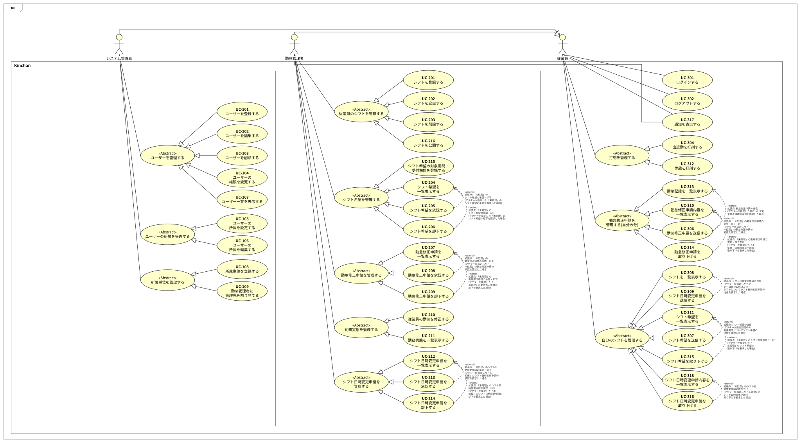

# ユースケース図(SVG 版・Mermaid 版)

astah の図(`usecase.asta`・`usecase.png`)は削除した。astah で起こし直すまでは、この SVG 版・Mermaid 版をユースケース図とする。UC ドキュメント(`UC-XXX.md`)43 件の内容から起こしたもので、astah に起こすときの元資料にもなる。

## SVG 版

`usecase.svg` は、従来の astah の図と同じ配置(アクターが上、システム境界の中にアクターごとのレーン、«Abstract» への汎化)で描いたもの。内容は下の Mermaid 版・一覧と同じ。

## Mermaid 版

- 実線(矢印なし): アクターと UC の関連
- 実線の矢印: 汎化(矢印の先が親)。アクターの汎化と、«Abstract» の UC への汎化
- 点線の矢印 «extend»: 拡張(矢印の先が拡張される側の UC)。各 UC ドキュメントの「拡張点」「関連ユースケース」のとおり
- «Abstract» の UC は、図の見やすさのためのまとまりで、UC ドキュメントは無い(従来の astah の図の形を踏襲)
- 1 行目の `flowchart LR` を `flowchart TB` に変えると、アクターが上・レーンが横並びの、従来の astah の図に近い配置になる(横に長くなる)

```mermaid
flowchart LR
    classDef actor fill:#fff,stroke:#333,stroke-width:1px
    classDef abstract fill:#ffffcc,stroke:#999,stroke-dasharray:4 2
    classDef uc fill:#ffffcc,stroke:#333

    actEmp["従業員"]:::actor
    actMgr["勤怠管理者"]:::actor
    actAdm["システム管理者"]:::actor

    actMgr --> actEmp
    actAdm --> actEmp

    subgraph sys["Kinchan"]
        direction LR

        subgraph adm["システム管理者"]
            Guser(["«Abstract»<br>ユーザーを管理する"]):::abstract
            U103(["UC-103<br>ユーザーを登録する"]):::uc
            U104(["UC-104<br>ユーザーを編集する"]):::uc
            U105(["UC-105<br>ユーザーを削除する"]):::uc
            U106(["UC-106<br>ユーザーの権限を変更する"]):::uc
            U116(["UC-116<br>ユーザー一覧を表示する"]):::uc
            Gbelong(["«Abstract»<br>ユーザーの所属を管理する"]):::abstract
            U110(["UC-110<br>ユーザーの所属を設定する"]):::uc
            U111(["UC-111<br>ユーザーの所属を編集する"]):::uc
            Gunit(["«Abstract»<br>所属単位を管理する"]):::abstract
            U117(["UC-117<br>所属単位を登録する"]):::uc
            U118(["UC-118<br>勤怠管理者に管理先を割り当てる"]):::uc
        end

        subgraph mgr["勤怠管理者"]
            Gshift(["«Abstract»<br>従業員のシフトを管理する"]):::abstract
            U203(["UC-203<br>シフトを登録する"]):::uc
            U204(["UC-204<br>シフトを変更する"]):::uc
            U205(["UC-205<br>シフトを削除する"]):::uc
            U218(["UC-218<br>シフトを公開する"]):::uc
            Greq(["«Abstract»<br>シフト希望を管理する"]):::abstract
            U217(["UC-217<br>シフト希望の対象期間・受付期間を登録する"]):::uc
            U206(["UC-206<br>シフト希望を一覧表示する"]):::uc
            U207(["UC-207<br>シフト希望を承認する"]):::uc
            U208(["UC-208<br>シフト希望を却下する"]):::uc
            Gcorr(["«Abstract»<br>勤怠修正申請を管理する"]):::abstract
            U209(["UC-209<br>勤怠修正申請を一覧表示する"]):::uc
            U210(["UC-210<br>勤怠修正申請を承認する"]):::uc
            U211(["UC-211<br>勤怠修正申請を却下する"]):::uc
            Gwork(["«Abstract»<br>勤務実態を管理する"]):::abstract
            U212(["UC-212<br>勤怠を修正する"]):::uc
            U213(["UC-213<br>勤務実態を一覧表示する"]):::uc
            Gchg(["«Abstract»<br>シフト日時変更申請を管理する"]):::abstract
            U214(["UC-214<br>シフト日時変更申請を一覧表示する"]):::uc
            U215(["UC-215<br>シフト日時変更申請を承認する"]):::uc
            U216(["UC-216<br>シフト日時変更申請を却下する"]):::uc
        end

        subgraph emp["従業員"]
            U001(["UC-001<br>ログインする"]):::uc
            U002(["UC-002<br>ログアウトする"]):::uc
            U303(["UC-303<br>ホームを表示する"]):::uc
            U304(["UC-304<br>打刻をする"]):::uc
            U312(["UC-312<br>休憩を打刻する"]):::uc
            U305(["UC-305<br>勤務ステータスを変更する"]):::uc
            U317(["UC-317<br>通知を表示する"]):::uc
            Gmycorr(["«Abstract»<br>勤怠修正申請を管理する(自分の分)"]):::abstract
            U313(["UC-313<br>勤怠記録を一覧表示する"]):::uc
            U306(["UC-306<br>勤怠修正申請を送信する"]):::uc
            U310(["UC-310<br>勤怠修正申請内容を一覧表示する"]):::uc
            U314(["UC-314<br>勤怠修正申請を取り下げる"]):::uc
            Gmyshift(["«Abstract»<br>自分のシフトを管理する"]):::abstract
            U308(["UC-308<br>シフトを一覧表示する"]):::uc
            U307(["UC-307<br>シフト希望を送信する"]):::uc
            U311(["UC-311<br>シフト希望を一覧表示する"]):::uc
            U315(["UC-315<br>シフト希望を取り下げる"]):::uc
            U309(["UC-309<br>シフト日時変更申請を送信する"]):::uc
            U318(["UC-318<br>シフト日時変更申請内容を一覧表示する"]):::uc
            U316(["UC-316<br>シフト日時変更申請を取り下げる"]):::uc
        end
    end

    %% アクターと UC の関連
    actAdm --- Guser
    actAdm --- Gbelong
    actAdm --- Gunit
    actMgr --- Gshift
    actMgr --- Greq
    actMgr --- Gcorr
    actMgr --- Gwork
    actMgr --- Gchg
    actMgr --- U317
    actEmp --- U001
    actEmp --- U002
    actEmp --- U303
    actEmp --- U304
    actEmp --- U312
    actEmp --- U305
    actEmp --- U317
    actEmp --- Gmycorr
    actEmp --- Gmyshift

    %% «Abstract» への汎化
    U103 --> Guser
    U104 --> Guser
    U105 --> Guser
    U106 --> Guser
    U116 --> Guser
    U110 --> Gbelong
    U111 --> Gbelong
    U117 --> Gunit
    U118 --> Gunit
    U203 --> Gshift
    U204 --> Gshift
    U205 --> Gshift
    U218 --> Gshift
    U217 --> Greq
    U206 --> Greq
    U207 --> Greq
    U208 --> Greq
    U209 --> Gcorr
    U210 --> Gcorr
    U211 --> Gcorr
    U212 --> Gwork
    U213 --> Gwork
    U214 --> Gchg
    U215 --> Gchg
    U216 --> Gchg
    U313 --> Gmycorr
    U306 --> Gmycorr
    U310 --> Gmycorr
    U314 --> Gmycorr
    U308 --> Gmyshift
    U307 --> Gmyshift
    U311 --> Gmyshift
    U315 --> Gmyshift
    U309 --> Gmyshift
    U318 --> Gmyshift
    U316 --> Gmyshift

    %% 拡張(拡張する UC → 拡張される UC)
    U207 -. "«extend»" .-> U206
    U208 -. "«extend»" .-> U206
    U210 -. "«extend»" .-> U209
    U211 -. "«extend»" .-> U209
    U215 -. "«extend»" .-> U214
    U216 -. "«extend»" .-> U214
    U304 -. "«extend»" .-> U303
    U312 -. "«extend»" .-> U303
    U317 -. "«extend»" .-> U303
    U307 -. "«extend»" .-> U303
    U309 -. "«extend»" .-> U308
    U306 -. "«extend»" .-> U310
    U314 -. "«extend»" .-> U310
    U307 -. "«extend»" .-> U311
    U315 -. "«extend»" .-> U311
    U306 -. "«extend»" .-> U313
    U316 -. "«extend»" .-> U318
```

## astah に起こすときの一覧

### アクター

| アクター | 汎化(親) | 根拠 |
| --- | --- | --- |
| 従業員 | — | 全ユーザーが従業員として振る舞える(#83)。ログイン・ログアウト(UC-001・002)も従業員の UC とする(2026-10-22の会話) |
| 勤怠管理者 | 従業員 | 勤怠管理者権限を持つユーザー。従業員としても振る舞う(#83、UC-317) |
| システム管理者 | 従業員 | システム管理者権限を持つユーザー。従業員としても振る舞う(#83) |

従来の astah の図では 管理者・勤怠管理者・従業員 の 3 つがそれぞれ ユーザー を親にしていた。#83 の決定(権限としての「従業員」は無く、全ユーザーが従業員として振る舞う)に合わせ、アクター「ユーザー」をやめ、勤怠管理者・システム管理者の親を 従業員 にしている。

### UC と «Abstract» のまとまり

| アクター | «Abstract» | UC |
| --- | --- | --- |
| システム管理者 | ユーザーを管理する | UC-103、UC-104、UC-105、UC-106、UC-116 |
| システム管理者 | ユーザーの所属を管理する | UC-110、UC-111 |
| システム管理者 | 所属単位を管理する | UC-117、UC-118 |
| 勤怠管理者 | 従業員のシフトを管理する | UC-203、UC-204、UC-205、UC-218 |
| 勤怠管理者 | シフト希望を管理する | UC-217、UC-206、UC-207、UC-208 |
| 勤怠管理者 | 勤怠修正申請を管理する | UC-209、UC-210、UC-211 |
| 勤怠管理者 | 勤務実態を管理する | UC-212、UC-213 |
| 勤怠管理者 | シフト日時変更申請を管理する | UC-214、UC-215、UC-216 |
| 従業員 | — | UC-001、UC-002、UC-303、UC-304、UC-312、UC-305 |
| 従業員 | 勤怠修正申請を管理する(自分の分) | UC-313、UC-306、UC-310、UC-314 |
| 従業員 | 自分のシフトを管理する | UC-308、UC-307、UC-311、UC-315、UC-309、UC-318、UC-316 |
| 従業員、勤怠管理者 | — | UC-317 |

### 拡張(«extend»)

拡張する UC → 拡張される UC(拡張点)。各 UC ドキュメントの表の「拡張点」と「関連ユースケース」のとおり。

| 拡張される UC | 拡張点 | 拡張する UC |
| --- | --- | --- |
| UC-206 シフト希望を一覧表示する | 「未処理」のシフト希望の承認・却下 | UC-207、UC-208 |
| UC-209 勤怠修正申請を一覧表示する | 「未処理」の勤怠修正申請の承認・却下 | UC-210、UC-211 |
| UC-214 シフト日時変更申請を一覧表示する | 「未処理」のシフト日時変更申請の承認・却下 | UC-215、UC-216 |
| UC-303 ホームを表示する | 出勤・退勤の打刻 / 休憩の打刻 / 通知の表示 / シフト希望の送信 | UC-304、UC-312、UC-317、UC-307 |
| UC-308 シフトを一覧表示する | シフト日時変更申請の送信 | UC-309 |
| UC-310 勤怠修正申請内容を一覧表示する | 「未処理」の勤怠修正申請の変更・取り下げ | UC-306(変更)、UC-314 |
| UC-311 シフト希望を一覧表示する | シフト希望の送信 / 「未処理」のシフト希望の取り下げ | UC-307、UC-315 |
| UC-313 勤怠記録を一覧表示する | 勤怠修正申請の送信 | UC-306 |
| UC-318 シフト日時変更申請内容を一覧表示する | 「未処理」のシフト日時変更申請の取り下げ | UC-316 |

### 従来の図からの変更

- 統合: UC-106(UC-107 を吸収)
- 削除: UC-107、UC-112〜115(勤務可能時間・休憩時間。#77・#78)
- 新設(ID は仮): UC-117、UC-118、UC-217、UC-218、UC-312〜318
- 改名(暫定名。requirements.md の改名は別途): UC-106「ユーザーの権限を変更する」、UC-110「ユーザーの所属を設定する」、UC-111「ユーザーの所属を編集する」、UC-303「ホームを表示する」、UC-308「シフトを一覧表示する」
- アクター名: 「管理者」→「システム管理者」(#83)。アクター「ユーザー」は廃止し、UC-001・002 のアクターは従業員(2026-10-22の会話)
- UC-305 は従業員が直接起動する UC ではなく、UC-304・312 の打刻の記録を開始条件とする(UC-305 備考)。図では従来どおり従業員との関連で表す
